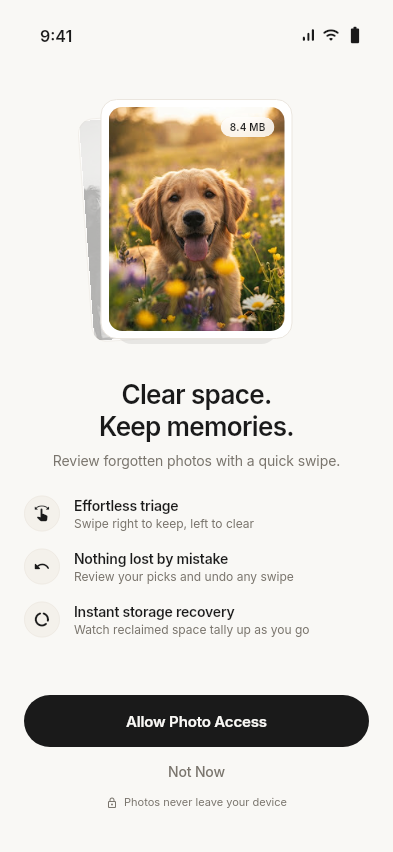
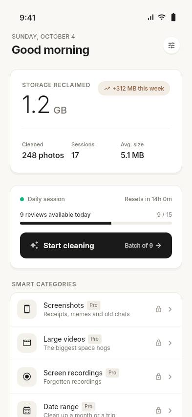
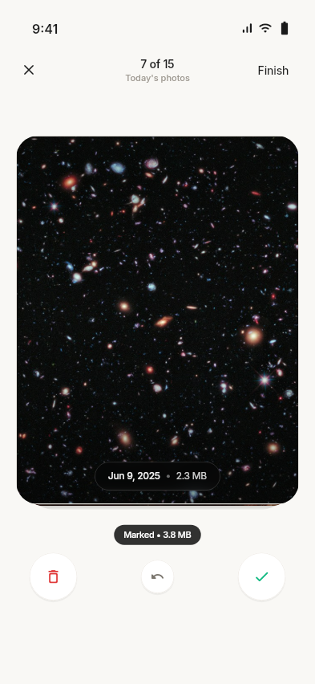
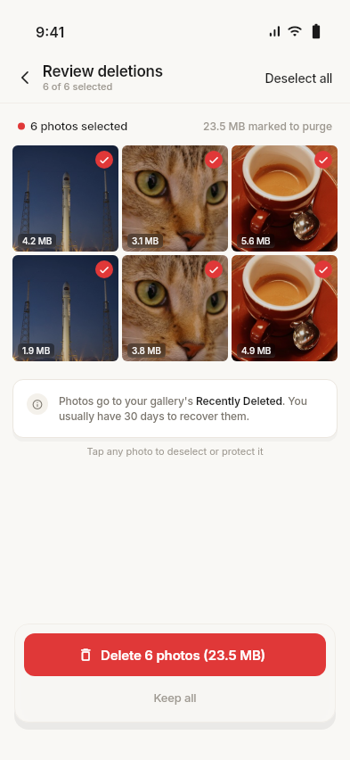
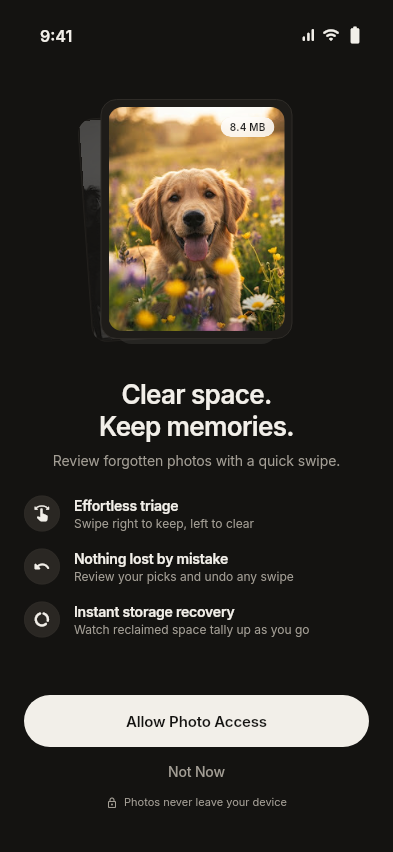
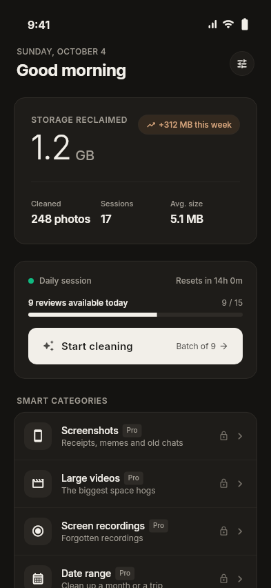
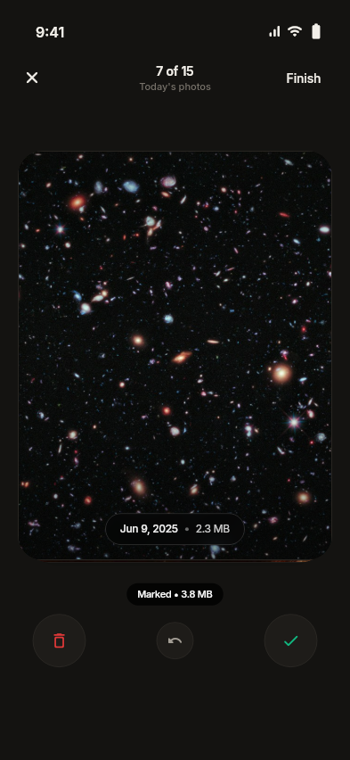
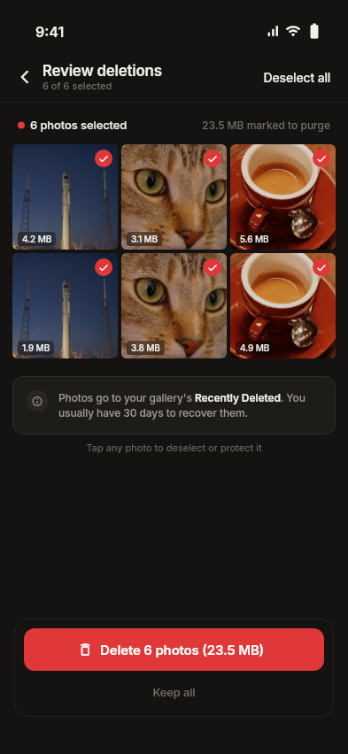

# SnapSweep

[](https://github.com/HasanNarli/snap_sweep/actions/workflows/ci.yml)


**Swipe to clean up your photo gallery.** SnapSweep shows you random photos from your gallery one at a time: swipe left to delete, right to keep. When the session ends, you review everything you marked and delete it in one go, and the app shows how much space you freed.

Your photos never leave your phone. There is no server and no upload; everything happens on the device.

> Status: in active development (Flutter, Android + iOS). Core flow is complete; polish and premium features are in progress.

| Onboarding | Home | Swipe | Review |
|---|---|---|---|
|  |  |  |  |
|  |  |  |  |

<sub>Rendered from the real app by `flutter test tool/screenshots --update-goldens` (Turkish variants are in [docs/screenshots](docs/screenshots)).</sub>

## Features

- **Swipe to decide.** Tinder-style card stack with undo and haptic feedback. Swiping never deletes immediately; photos go to a "to delete" list.
- **Review and batch delete.** A grid of marked photos with per-photo sizes, select or deselect all, then a single system confirmation deletes them.
- **Freed space and stats.** See how much space each session freed, plus totals on the home screen.
- **Daily sessions.** Free users get a fixed number of random photos per day; the quota resets at local midnight and undo refunds a swipe.
- **Proper permission handling.** Full, limited (iOS "selected photos", Android 14 partial access) and denied states each have their own flow.
- **Turkish and English** from day one, with light and dark themes that follow the system.

## Technical highlights

- **Never loads the whole gallery.** The app reads the total photo count and fetches assets at random indexes in parallel, so memory use stays flat no matter how large the gallery is.
- **Thumbnail cache and prefetch.** An LRU cache keyed by asset and size, shared by in-flight loads; the next cards are loaded ahead so they are ready when swiped to. Failed loads aren't cached, so they can retry.
- **Riverpod state.** The swipe session is an auto-disposed `AsyncNotifier`, so every visit starts fresh; the daily quota rolls over on app resume.
- **Design system.** Semantic color tokens (`AppPalette`), spacing scale and shared components (grouped lists, frosted pills, round icon buttons). No hard-coded colors in widgets.
- **Tested.** Unit and widget tests for the swipe session, daily quota, review flow and utilities; CI runs formatting, analysis and tests on every push.

## Tech stack

| Area | Packages |
|---|---|
| State management | `flutter_riverpod` |
| Navigation | `go_router` |
| Gallery access and deletion | `photo_manager` |
| Card stack | `flutter_card_swiper` |
| Local storage | `shared_preferences` |
| Localization | `flutter_localizations`, `intl` (ARB files) |

## Project structure

```
lib/
├── core/        # theme, router, config, storage, utilities
├── features/    # one folder per feature
│   ├── onboarding/   permission/   home/
│   ├── gallery/      swipe/        review/
│   ├── quota/        stats/        settings/
├── shared/      # reusable widgets
└── l10n/        # TR + EN translations
```

## Getting started

Requires Flutter 3.47 or newer (Dart 3.13+) and Xcode for iOS.

```bash
flutter pub get
flutter run
flutter test
```

Gallery access needs a real device or a simulator with photos in its library.

## Roadmap

- [x] Foundation: theme, routing, TR/EN localization
- [x] Onboarding and gallery permission (full, limited, denied)
- [x] Swipe screen: random photos, undo, to-delete list
- [x] Review, batch delete and result screen
- [x] Home: daily sessions, stats
- [ ] Polish: app icon, splash and large-gallery performance done; real-device testing in progress
- [ ] Premium: unlimited swipes and filters (screenshots, videos, date range)
- [ ] Similar and duplicate photo detection

## License

All rights reserved. The source is public for portfolio and evaluation purposes only; see [LICENSE](LICENSE).

## Author

**Hasan Narlı**, Mobile Developer (iOS & Flutter) · [LinkedIn](https://www.linkedin.com/in/hasannarli/) · [GitHub](https://github.com/HasanNarli)
